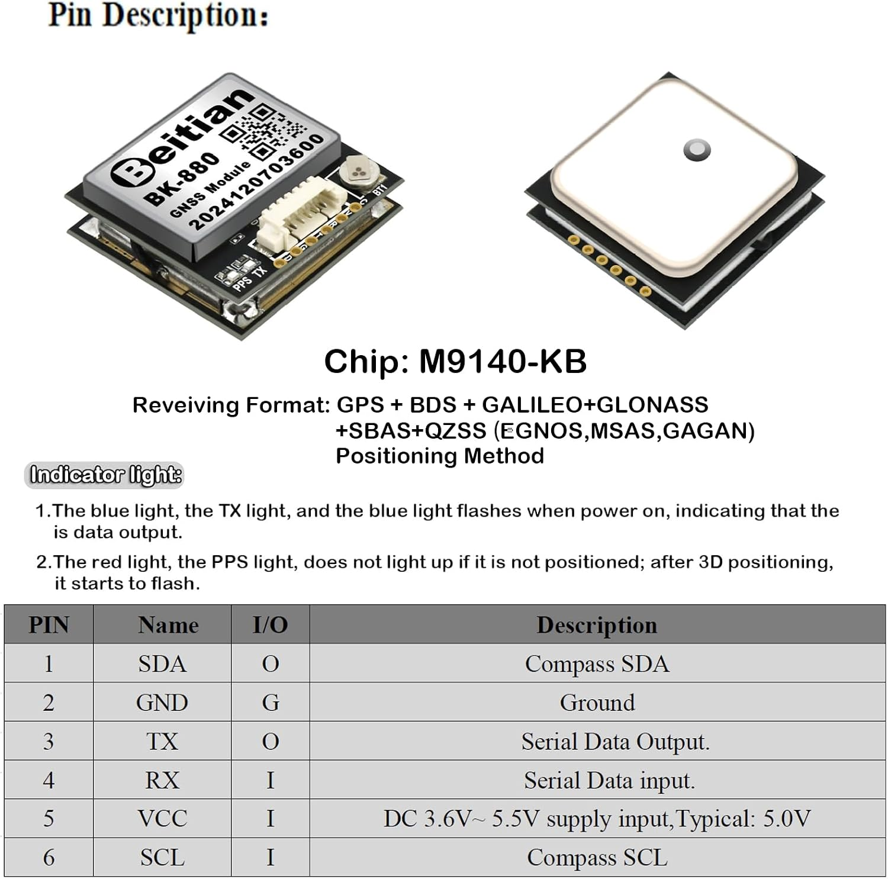
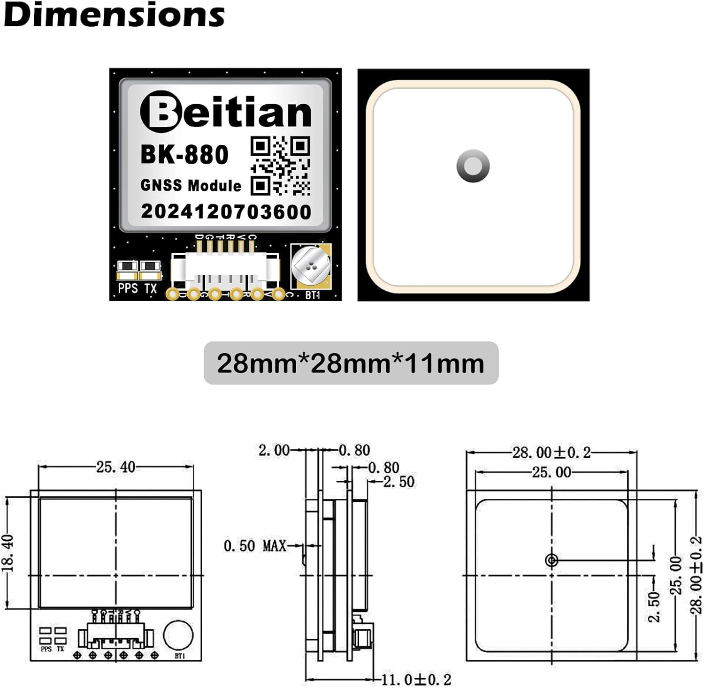

# Beitian BK-880 reference material

Copies of the vendor reference material for the Beitian BK-880 GNSS module (with compass), kept here so the BonoGPS builds that use it don't depend on outside links.

| File | Contents |
|---|---|
| [BK-880-pinout.jpg](BK-880-pinout.jpg) | Pin description, indicator LEDs, chip (M9140-KB) and supported constellations |
| [BK-880-dimensions.jpg](BK-880-dimensions.jpg) | Mechanical drawing: 28 × 28 × 11 mm |
| [BN-880-datasheet.pdf](BN-880-datasheet.pdf) | BN-880 datasheet. The BK-880 has the same pinout, supply range (3.6-5.5V) and LEDs, but a different chip (M9140 vs M8030), update rate and height, so ignore the datasheet's 10Hz limit. |

## Summary

- **Chip:** M9140-KB
- **Constellations:** GPS, BDS, Galileo, GLONASS, SBAS, QZSS
- **Supply (VCC):** 3.6-5.5V, typically 5.0V. It can't run from a 3.3V rail.
- **UART logic level:** 3.3V. TX and RX connect straight to an ESP32 with no level shifting.
- **Connector:** 6-pin JST-GH 1.25mm
- **Size:** 28 × 28 × 11 mm. The ceramic patch antenna is on the opposite side from the label. Mount the module with the antenna side facing the sky.

| Pin | Name | I/O | Description |
|---|---|---|---|
| 1 | SDA | O | Compass SDA |
| 2 | GND | G | Ground |
| 3 | TX | O | Serial data output |
| 4 | RX | I | Serial data input |
| 5 | VCC | I | DC 3.6-5.5V supply input, typically 5.0V |
| 6 | SCL | I | Compass SCL |

**Indicator LEDs:**
- **TX (blue):** flashes when the module is sending data.
- **PPS (red):** off until the module has a 3D fix, then flashes.

## See also

- [GPS configuration guide](../README.md): configuring the BK-880 for 25Hz
- [LilyGO T-Energy-S3 case](../../assembled/models/LilygoT-EnergyS3Case/README.md): a complete build using the BK-880
