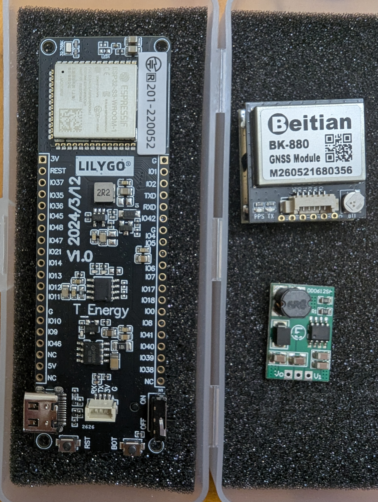
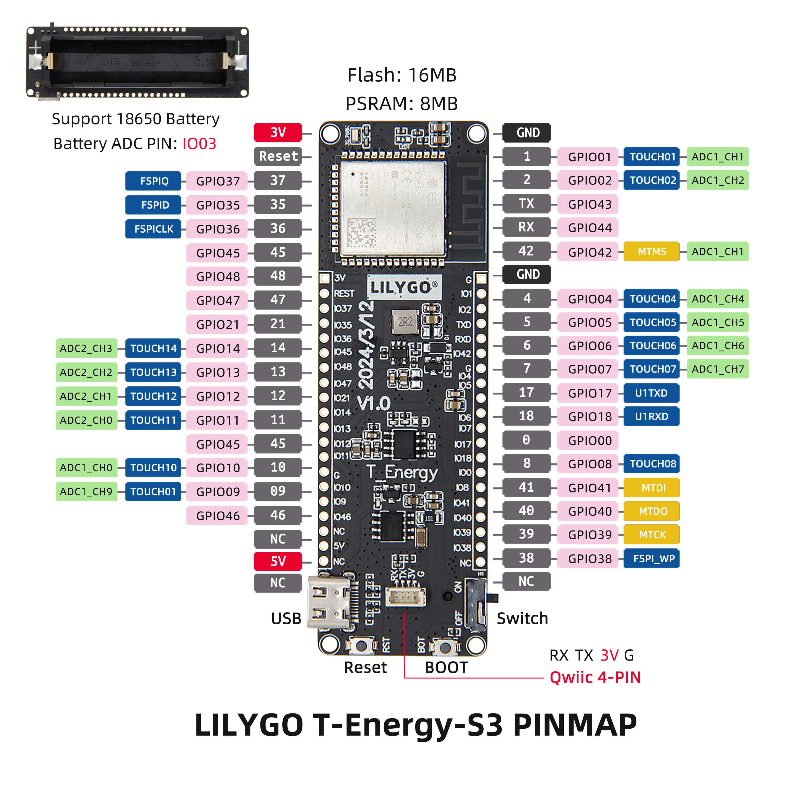
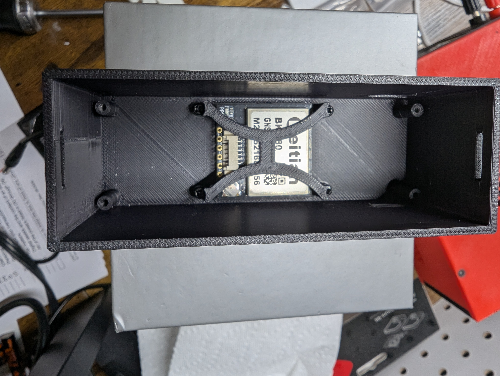
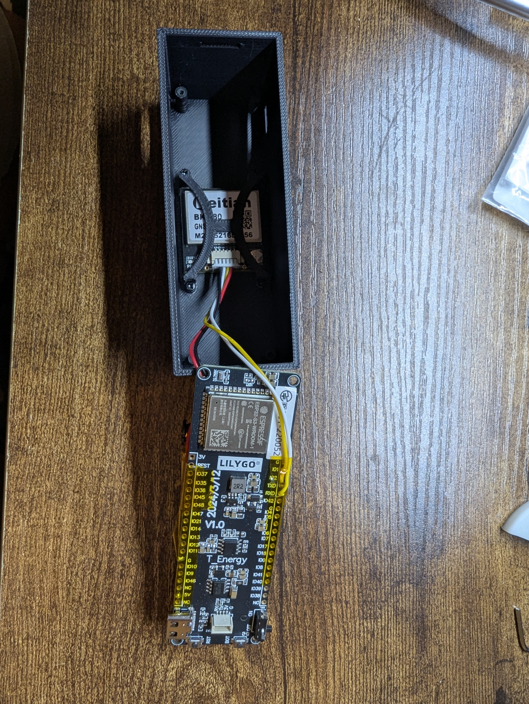
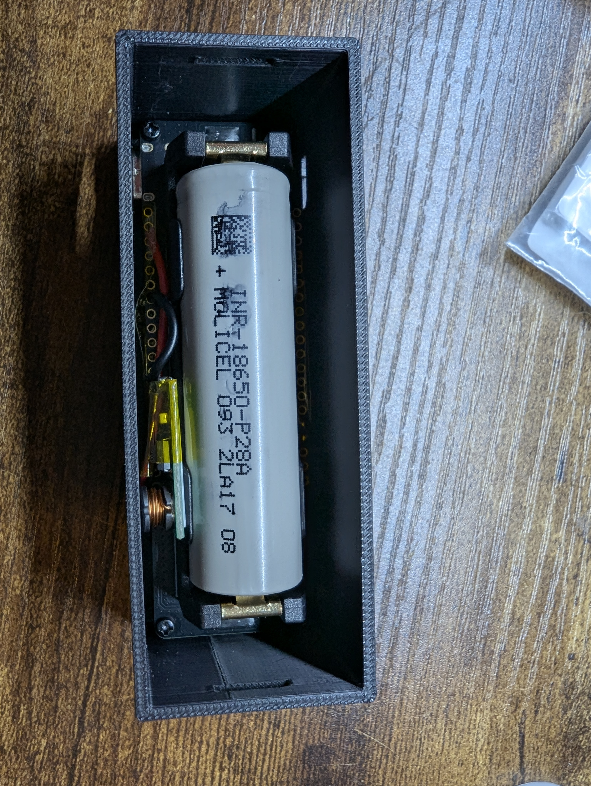
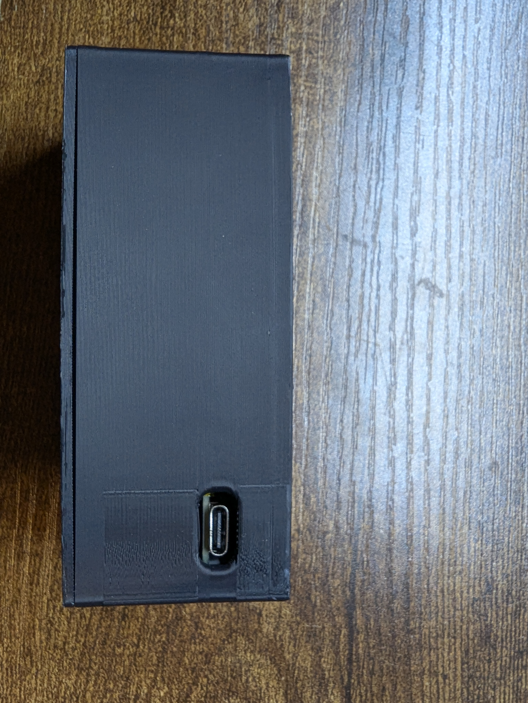
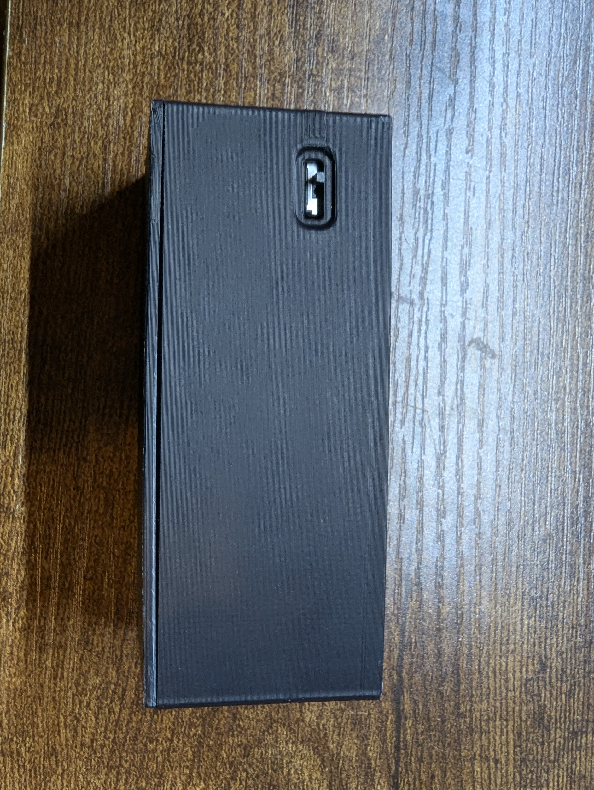

# LilyGO T-Energy-S3 + BK-880 case

A 3D printed enclosure for BonoGPS built around the LilyGO T-Energy-S3 (an ESP32-S3 board with a built-in 18650 holder, charger and protection circuit), a Beitian BK-880 GNSS module and a DD0612SA 5V boost module. One slide switch turns both the ESP32 and the GPS on and off. The battery charges over USB-C.

**⏱️ Time:** 1-2 hours (plus printing) | **🎯 Difficulty:** Intermediate | **Prerequisites:** Soldering, a multimeter, 3D printer access

- [Bill of materials](#bill-of-materials)
- [How the power works](#how-the-power-works)
- [Wiring](#wiring)
- [Assembly](#assembly)
- [Firmware](#firmware)
- [Testing](#testing)
- [Things to know](#things-to-know)



## Bill of materials

### Electronics

| Qty | Part | Notes |
|---|---|---|
| 1 | [LilyGO T-Energy-S3](https://github.com/Xinyuan-LilyGO/T-Energy-S3) | ESP32-S3-WROOM-1 N16R8 (16MB flash, 8MB Octal PSRAM). Has an 18650 holder, a charger (HX6610S) and a protection IC (IP3005A) on board. |
| 1 | Beitian BK-880 GNSS module | Includes its 6-pin JST-GH 1.25mm cable. Needs 3.6-5.5V on VCC, so it can't run from the board's 3.3V pin. |
| 1 | DD0612SA boost module, **fixed 5V output** version | Takes 2.6-5V in and gives 5V out. Pads are `Vo` / GND / `Vi`. Measured output is about 5.3V. |
| 1 | 18650 Li-ion cell, e.g. Molicel INR-18650-P28A (2800mAh) | This build uses a flat-top cell without built-in protection; the board protects the cell itself. Check polarity against the holder markings. |

### Hardware and consumables

| Qty | Part | Notes |
|---|---|---|
| 8 | 2.5mm self-tapping screws | 4 hold the T-Energy-S3 to the case standoffs and 4 hold the BK-880 retainer. |
| — | 26-28 AWG silicone hookup wire | Red/black for power, two colours for TX/RX. You can also cut and solder the BK-880's own cable. |
| — | Heat shrink tubing (small) | To cover solder joints. |
| — | Kapton tape | Insulates the DD0612SA where it lies against the board inside the case. |
| — | 3M Dual Lock with VHB adhesive (optional) | For mounting the case to the vehicle. The Fusion file has a pry tool for removing it. |

### Printed parts

All parts come from the Fusion 360 source [`../LilygoT-EnergyS3Case.f3d`](../LilygoT-EnergyS3Case.f3d). Export each body to STL or 3MF:

- Case body
- Lid
- BK-880 retainer (the X-shaped clamp)
- VHB Dual Lock pry tool (optional)

If the case will live in a car or under a motorcycle seat, print it in PETG or ASA. PLA can soften in a hot parked vehicle.

### Tools

Soldering iron, multimeter, small Phillips screwdriver, wire strippers, heat gun or lighter for the heat shrink.

## How the power works

The board's **"5V" header pin is not regulated 5V.** It carries the switched battery voltage (about 4.2V when full, down to about 3.0V when empty). When USB is connected it carries USB power minus a diode drop (4.8V measured). The DD0612SA turns that changing voltage into a steady 5V for the BK-880.

```
18650 ──> T-Energy-S3 holder ──> [slide switch] ──> "5V" pin ──> DD0612SA Vi
                                                                 DD0612SA Vo ──> BK-880 VCC
USB-C ──────────────────────────────────────────────> "5V" pin   (bypasses the switch)
```

- **The slide switch** turns the ESP32 and the GPS on and off together.
- **Charging** over USB-C works whatever the switch position. The board charges at about 500mA.
- **Plugging in USB powers everything,** even with the switch off. USB feeds the "5V" pin directly, so the ESP32 boots and the GPS powers up whenever USB is connected. There is no "charge only" mode.
- **Battery protection** (over-charge, over-discharge, short circuit) comes from the board's IP3005A. You don't need a protected cell or an extra protection board.
- **The blue LED** is a charger status LED, not a power LED. It is off on battery power, even when the board is running, so use the web UI or a multimeter to check that the board is on. It also lights when the cell is inserted backwards, even with the slide switch off: if it comes on with a cell in and no USB connected, take the cell out straight away.

## Wiring

### Pin map

T-Energy-S3 header pinout (source: LilyGO). This build uses `5V` on the left header and `GND`, `TX` (GPIO43) and `RX` (GPIO44) on the right header.



BK-880 cable pinout (JST-GH 1.25mm, 6-pin). The full pinout, dimensions and datasheet are in [`hardware/GPS/BK880`](../../../GPS/BK880/README.md).

| BK-880 pin | Signal | Connects to |
|---|---|---|
| 1 | SDA | not connected (compass, unused) |
| 2 | GND | T-Energy-S3 `G` and DD0612SA GND |
| 3 | TX | T-Energy-S3 `RXD` (GPIO44), direct |
| 4 | RX | T-Energy-S3 `TXD` (GPIO43), direct |
| 5 | VCC | DD0612SA `Vo` |
| 6 | SCL | not connected (compass, unused) |

T-Energy-S3 to DD0612SA:

| T-Energy-S3 | DD0612SA |
|---|---|
| `5V` (left header, near the USB end) | `Vi` |
| `G` | GND (middle pad) |

### Schematic

```
                          T-Energy-S3
                     ┌───────────────────┐
     DD0612SA        │                   │
   ┌──────────┐      │                   │
   │ Vi  <────┼──────┤ 5V                │
   │ GND <────┼──┬───┤ G                 │
   │ Vo  ─────┼┐ │   │                   │
   └──────────┘│ │   │     TXD (GPIO43) ─┼──────────────────────> BK-880 RX  (pin 4)
               │ │   │                   │
               │ │   │     RXD (GPIO44) ─┼──────────────────────< BK-880 TX  (pin 3)
               │ │   └───────────────────┘
               │ └──────────────────────────────────────────────  BK-880 GND (pin 2)
               └────────────────────────────────────────────────> BK-880 VCC (pin 5)
```

### TX logic level

The BK-880's TX and RX lines run at 3.3V logic, even though the module is powered from 5V. Both lines connect straight to the ESP32-S3 with no level shifting or resistors.

### Pins to avoid

- **GPIO35/36/37:** used internally by the Octal PSRAM on this module, even though they appear on the header.
- **GPIO0/3/45/46:** strapping pins. GPIO0 is the BOOT button, which the firmware uses as the WiFi mode button. GPIO3 is also the battery-sense input.
- **The `3V` pin (and the 3V pin on the 4-pin connector):** too low for the BK-880. Only use it for 3.3V parts.

The 4-pin connector next to the switch (RX/TX/3V/G) carries the same `RXD` (GPIO44) and `TXD` (GPIO43) signals as the header, according to the LilyGO schematic. You can use it for the UART instead of the header, but still take BK-880 VCC from the DD0612SA.

## Assembly

1. **Print the parts** listed under [Printed parts](#printed-parts).

2. **Check the DD0612SA on the bench before wiring it in.** Put 3.3-4.2V on `Vi`/GND and confirm `Vo` reads about 5.0-5.3V. Make sure you have the fixed 5V version. Don't change anything on the module.

3. **Make the GPS harness.** Use the BK-880 cable, or solder wires straight to the BK-880 pads.
   - Cut pins 1 (SDA) and 6 (SCL) short and cover them with heat shrink.

4. **Wire the power.** Solder short leads from the T-Energy-S3 `5V` and `G` pins to the DD0612SA `Vi` and GND pads. Then solder BK-880 VCC (pin 5) to `Vo` and BK-880 GND (pin 2) to the DD0612SA GND pad. Keep the wires short so they fit in the case.

5. **Wire the UART.** Solder BK-880 TX (pin 3) to header `RXD` (GPIO44). Solder BK-880 RX (pin 4) to header `TXD` (GPIO43).

6. **Insulate the DD0612SA** with Kapton tape on all sides. It sits next to the board's header pins inside the case, and the tape stops it from shorting against them.

7. **Check the wiring with the battery out, before closing the case.**
   - Continuity: BK-880 GND to T-Energy `G`.
   - Continuity: BK-880 VCC to DD0612SA `Vo`.
   - No short between `5V` and `G`.
   - Then plug in USB-C. `Vo` should read about 5.3V and the BK-880's blue TX LED should flash. The red PPS LED stays off until the GPS has a fix outdoors.

8. **Mount the BK-880.** Put it in its pocket in the case floor, connector toward the board end. Place the X-shaped retainer over it and fix it with **4 × 2.5mm self-tapping screws**. Tighten until snug only. Overtightened self-tapping screws strip printed plastic.

   

   

9. **Mount the T-Energy-S3.** Fold the board into the case with the 18650 holder facing up, the USB-C port at the USB cut-out and the slide switch at the switch cut-out. Tuck the DD0612SA and the wires beside it without pinching them. Fix it with **4 × 2.5mm self-tapping screws** through the corner holes into the standoffs.

10. **Fit the 18650** with the switch off and no USB connected, matching the `+` marking on the holder. The blue LED should stay off; if it lights, the cell is in backwards, so remove it at once. Then switch on: the board should boot.

    

11. **Fit the lid.** Check that the USB-C port and the power switch line up with their openings.

    | USB-C side | Power switch side |
    |---|---|
    |  |  |

12. **Mount the case** (optional) with 3M Dual Lock with VHB adhesive. Clean the surface with isopropyl alcohol first and let the adhesive cure for 24 hours before driving. Use the printed pry tool to remove it later. Mount it with a clear view of the sky, with no metal or carbon fibre above the antenna. The BK-880's patch antenna is on the opposite side from its label, so in this case it faces the case floor. That face needs to point at the sky.

## Firmware

The T-Energy-S3 is supported directly. Build with one of these PlatformIO environments in [`platformio.ini`](../../../../platformio.ini):

| Environment | Use |
|---|---|
| `t_energy_s3` | Production build, no logging |
| `t_energy_s3_ota` | Production build with OTA always on |
| `t_energy_s3_debug` | Verbose logging over USB CDC, OTA always on |

What the board profile (`LILYGO_T_ENERGY_S3` in [`include/bonogps_board_settings.h`](../../../../include/bonogps_board_settings.h)) sets:

- **GPS UART:** `RX2 = GPIO44`, `TX2 = GPIO43`. These pins are free because programming and serial use the ESP32-S3's native USB (`ARDUINO_USB_CDC_ON_BOOT=1`). If you turn that flag off, GPIO43/44 become the debug console and clash with the GPS.
- **WiFi mode button:** the BOOT button (GPIO0).
- **Status LED:** the board has no user LED, so `LED_BUILTIN` points at GPIO2 as a placeholder. Wire an LED and resistor to GPIO2 if you want to see WiFi status.
- **Battery display:** `GPIO_BATTERY = GPIO3`, but `SHOWBATTERY` is **off**. The scale factor in `ReadBatteryVoltage()` was calibrated for the LOLIN D32 Pro. Calibrate it against a multimeter reading of the cell before turning the display on.

**Connections:** the ESP32-S3 has no classic Bluetooth, so BT-SPP isn't available. Use BLE (Harry's Lap Timer on iOS, RaceChrono; tested on Android, not yet on iOS) or WiFi (TCP-IP). See [Connecting to an app](../../../../README.md#connecting-to-an-app).

Flashing works with the BK-880 connected and powered. Configure the GPS before first use; see the [GPS configuration guide](../../../GPS/README.md).

## Testing

- [ ] Switch on, battery only: the board boots and the `BonoGPS-XXXX` WiFi network appears (the blue LED stays off, which is normal; if it's on, the cell is reversed).
- [ ] The `5V` pin reads the battery voltage (about 3.0-4.2V) and DD0612SA `Vo` reads about 5.3V.
- [ ] Switch off, battery only: everything is off.
- [ ] USB-C connected: the battery charges (red LED while charging, blue when full) and the board runs whatever the switch position.
- [ ] Outdoors: the GPS gets a fix and the lap timer app receives data.
- [ ] Shake test: nothing rattles and no connection drops out.

## Things to know

- **Runtime:** the ESP32-S3 with WiFi or BLE plus the GPS draws about 150-350mA, so a 2800mAh cell should last roughly 8-15 hours. This is an estimate and hasn't been measured on this build.
- **USB power source:** when charging and running at the same time, the board can peak at around 800mA. This is an estimate (about 500mA charging plus WiFi peaks plus the GPS), not a measurement. Use a wall charger or powered hub rated for at least 1A and a good cable. Weak USB ports can cause brownout resets while flashing.
- **Storage:** with the switch off and USB unplugged, the board still draws a few tens of µA from the cell (protection IC, charger leakage and the battery-sense divider). For long storage, take the cell out.
- **Fixing a weak GPS signal:** see [Hardware Assembly Troubleshooting](../../README.md#hardware-assembly-troubleshooting).
