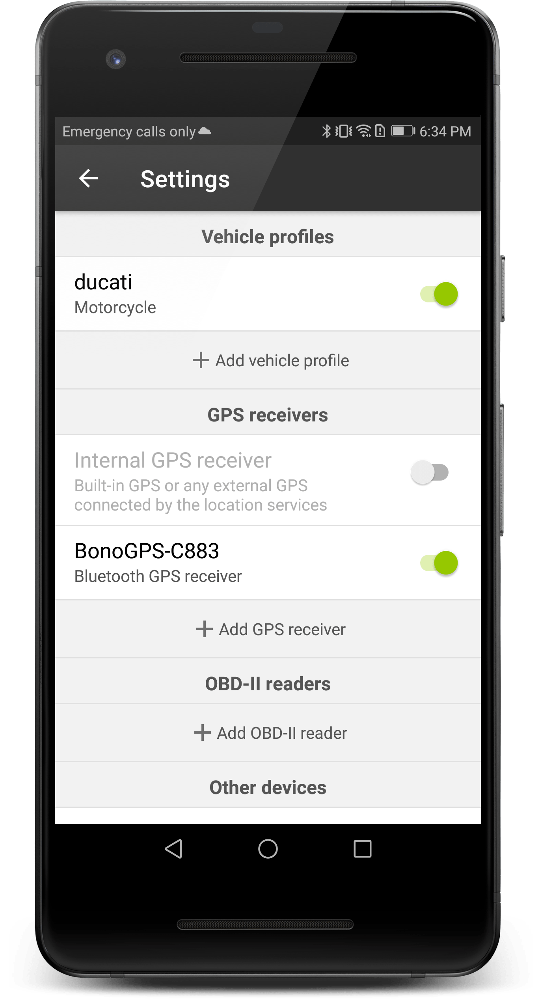
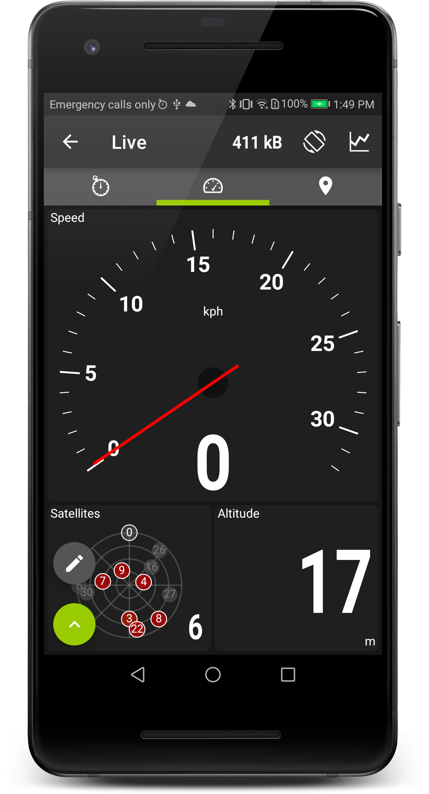
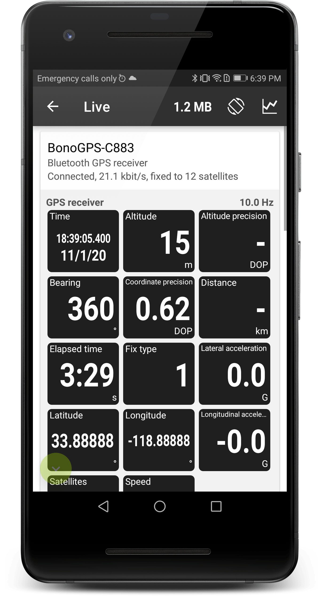
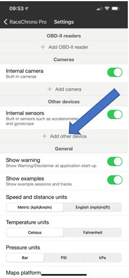
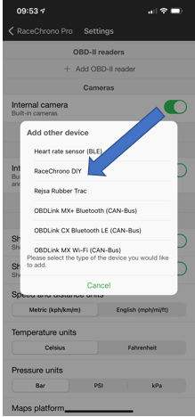
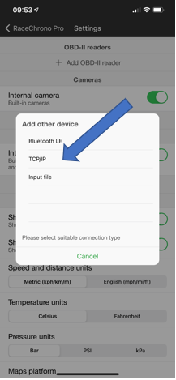
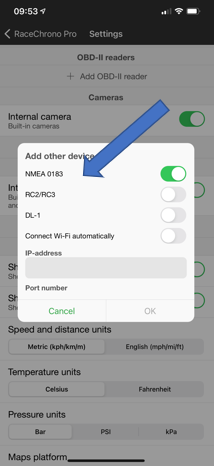
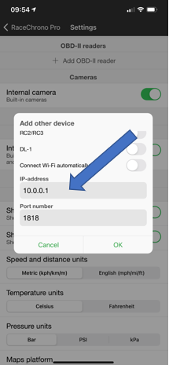

# RaceChrono

**⏱️ Time:** 10-15 minutes | **🎯 Difficulty:** Beginner | **Prerequisites:** Load RaceChrono preset from BonoGPS web interface

- [RaceChrono](#racechrono)
  - [Setup over BLE](#setup-over-ble)
  - [Setup over BT-SPP on Android](#setup-over-bt-spp-on-android)
  - [Setup over WiFi on iOS](#setup-over-wifi-on-ios)
  - [GPS configuration for NMEA messages](#gps-configuration-for-nmea-messages)

The lap timer with the cleanest UX currently supported: [https://racechrono.com/](https://racechrono.com/)

- tested with v7.0.10 free (thus satellites view untested) on Android
- BLE on Android (RaceChrono DIY device, binary GPS packets); iOS untested
- BT-SPP on Android
- TCP-IP for iOS
- GSA+GSV polling at 5 sec

## Setup over BLE

BonoGPS exposes the [RaceChrono BLE DIY](https://github.com/aollin/racechrono-ble-diy-device) GPS service (`0x1FF8`) whenever Bluetooth LE is on. Each fix is a single 20-byte notification instead of NMEA text, so 25 Hz fits comfortably over BLE. Because the phone does not join the BonoGPS WiFi network, **mobile data keeps working** during the session, and it runs alongside other BLE devices such as a RaceChrono DIY CAN-Bus reader. It works on every board, including the ESP32-S3 (no classic Bluetooth needed). Tested on Android; it hasn't been tested on iOS yet.

1. In the BonoGPS web page, open presets and load **RaceChrono > BLE: RaceChrono DIY device**, set the GPS rate you want (e.g. 25 Hz), then save the configuration
2. Optionally turn WiFi off on BonoGPS for the session: the ESP32 shares one radio between WiFi and Bluetooth
3. In RaceChrono, open settings from the gear icon, add a device, choose **RaceChrono DIY**, then the Bluetooth LE option, and pick `BonoGPS-XXXX` from the list. Use it as the GPS
4. Start recording: GPS info (fix, satellite count, speed) should populate. The satellite sky view needs an NMEA connection (BT-SPP or WiFi), because the BLE packets only carry the satellite count

Notes:
- The GPS is set to GGA + RMC with GSA and GSV polled every 5 seconds; the encoder reads GGA and RMC, and VDOP from GSA
- Speed is sent in km/h as the spec requires; if RaceChrono's speed ever looks about 1.85x off, the knots-to-km/h conversion is the place to check

## Setup over BT-SPP on Android

Not available on ESP32-S3 boards such as the LilyGO T-Energy-S3 (no classic Bluetooth radio): use BLE or WiFi instead.

Open settings from the gear icon in the main page, then add a bluetooth receiver selecting your BonoGPS unit

When you start recording (the round big "start" button) if everything goes well you'll be able to see the constellations of satellites in the dashboard view

When you click on the lower left green "swipe up" icon, you'll be able to see further information about the GPS status

## Setup over WiFi on iOS

Make sure you have connected your iPhone to the AP on the BonoGPS device as you would to perform the setup

Open settings from the gear icon in the main page, then add an Internal sensor

Select "RaceChrono DIY" as the next option 

Under the "Add other device" select TCP/IP 

This next section requires several selections, step 1, enable the "NMEA 0183" slider 

On the same page as above now set your target IP address and port, the default is shown below but if you have changed the network and the port in the code please put the updated values in. 

When you start recording (the round big "start" button) if everything goes well you'll be able to see the constellations of satellites in the dashboard view

When you click on the lower left green "swipe up" icon, you'll be able to see further information about the GPS status

## GPS configuration for NMEA messages

Instructions directly from the SW Developer of RaceChrono in the support forum point out [here](https://racechrono.com/forum/discussion/comment/11252/#Comment_11252) and [here](https://racechrono.com/forum/discussion/1421/best-settings-for-qstarz818xt)

- Sentences need to start with `$GP`
- Only `GGA+RMC` or `RMC+VTG+ZDA` combinations are used
- `GSA+GSV` are optional
- `GBS` sentence is not used

This means

- Main Talker ID = GP
- `GSA` and `GSV` every 5 seconds, with only `GSV` restricted to GP

**See also:**
- [GPS Configuration Guide](../../../hardware/GPS) - How to set up GP Talker ID and NMEA messages
- [Main Troubleshooting FAQ](../../../README.md#troubleshooting-and-faq) - Connection and GPS issues
- [Other Supported Apps](../) - Compare with Harry's Lap Timer, TrackAddict, RaceTime